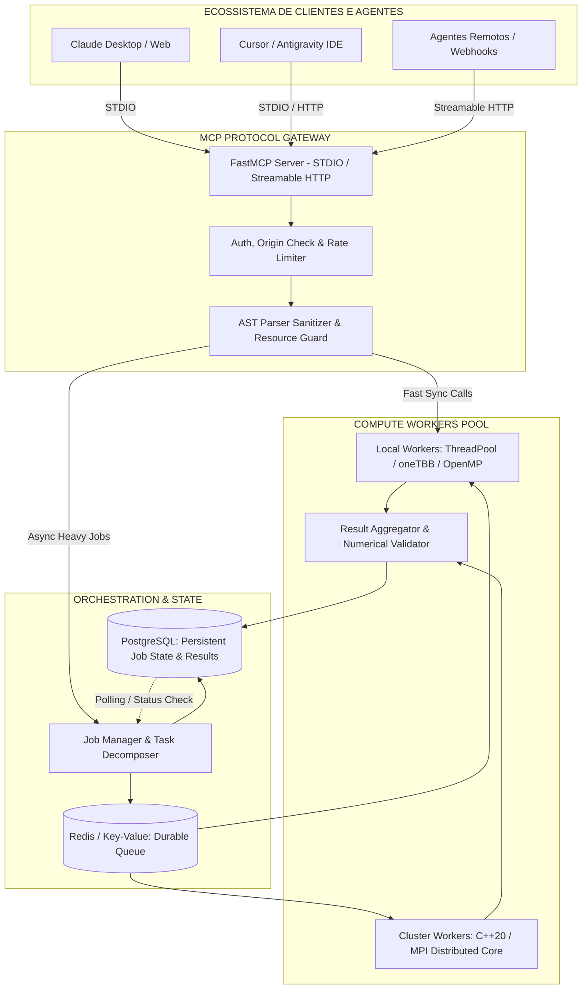

# MATHFORGE MCP: MASTER PLAN DE ARQUITETURA E IMPLEMENTAÇÃO
**Nome do Produto:** MathForge  
**Identificador do Repositório:** `mathforge-mcp` (`canalqb/math-intelligence-mcp`)  
**Nome do Núcleo:** MathForge Core  
**Servidor MCP:** MathForge MCP  
**Plataforma Distribuída:** MathForge Distributed Engine  
**Versão da Especificação:** 2.1.0-REV (Revisão Arquitetural Validada e Aprovada)  
**Status do Projeto:** Fase 0 — Fundação, Contratos de Interface e Hardening  
**Público-Alvo:** Engenheiros de Sistemas, Desenvolvedores de Core C++/Python, Arquitetos de Nuvem e Agentes Autônomos (Claude 3.5/Opus, GPT-4o/o1/o3, Gemini 2.0/3.0, DeepSeek R1/V3, Kimi, Cursor, Antigravity)

---

## 1. PARECER TÉCNICO DE VALIDAÇÃO (AUDITORIA ARQUITETURAL 2.1)

A auditoria técnica avaliou a proposta inicial com nota **7,5/10**, destacando excelente modularidade e separação de camadas, porém apontando bloqueadores críticos (**P0**) e correções de projeto (**P1**) obrigatórias antes da transição para produção. Este documento consolida a resolução de todos os apontamentos da auditoria.

### 1.1. Matriz de Avaliação e Ajustes Aplicados

| Dimensão Arquitetural | Nota Preliminar | Ação Corretiva Implementada na Revisão 2.1 |
| :--- | :---: | :--- |
| **Arquitetura Modular** | 9/10 | Mantida a separação em 4 camadas com interfaces C-ABI e desacoplamento total. |
| **Integração MCP** | 8/10 | Alinhamento rigoroso à especificação oficial (2024-11-05+), usando `tools/call`, ciclo de vida completo e Streamable HTTP. |
| **Precisão Matemática** | 8/10 | Modos explícitos (`FAST`, `HIGH`, `EXACT`, `AUTO`), diferenciação formal entre igualdade simbólica e aproximação numérica. |
| **Processamento Distribuído** | 6/10 | Desacoplamento de MPI da camada de mensageria: adição de Redis (Broker) e PostgreSQL (Estado) com tarefas recuperáveis. |
| **Segurança e Sandboxing** | 6/10 | Substituição de sanitização ingênua por Parser de Gramática Matemática Restrita, limites de AST e isolamento por processo com cotas de SO. |
| **Multiplataforma** | 7/10 | CMake baseado em `find_package()`, presets com `vcpkg` no Windows e pacotes de sistema no Linux. |
| **Plano de Testes e Produção** | 6/10 | Expansão para cronograma de 18 semanas em 8 fases, testes diferenciais, property-based testing (Hypothesis) e benchmarks. |

---

## 2. RESOLUÇÃO DOS BLOQUEADORES CRÍTICOS (P0)

### 2.1. Desmistificação do "Zero-Dependency" -> Adoção do *Python Portable Core*
A denominação preliminar de "Zero-Dependency" foi formalmente corrigida. A camada em Python é agora definida como **Python Portable Core — Instalação Simplificada**.
* **Responsabilidade de Cada Componente:**
  * **Python Standard Library:** Protocolo MCP, validação de tipos, orquestração e sanitização.
  * **SymPy:** Matemática simbólica, simplificação algébrica e equações exatas.
  * **mpmath:** Ponto flutuante de precisão arbitrária configurável (50 a 1.000 dígitos).
  * **NumPy:** Vetorização e matrizes `float64` de alto desempenho.
  * **SciPy:** Algoritmos numéricos avançados, otimização e distribuições estatísticas.
  * **C++20 Native Engine:** Aceleração massiva, laços intensivos e manipulação de memória de baixo nível.
  * **GMP & MPFR:** Aritmética de inteiros gigantescos e ponto flutuante multiprecisão com arredondamento IEEE estrito.
* **Métricas de Startup:** Todos os tempos de importação, carga de dependências e alocação inicial são medidos em benchmark contínuo (`cold-start` vs. `warm-start`).

### 2.2. Segurança e Sandboxing Matemático Determinado (AST Hardening & Process Isolation)
A simples filtragem por expressões regulares e verificação ingênua de nós AST foi substituída por uma **Defesa em Profundidade com Quatro Níveis de Isolamento**:

```
[Entrada de String do Agente de IA]
             │
             ▼
┌────────────────────────────────────────────────────────┐
│ NÍVEL 1: GRAMÁTICA FORMAL E PARSER MATEMÁTICO RESTRITO │
│ • Whitelist estrita de operadores (+, -, *, /, ^, mod) │
│ • Whitelist de funções (sin, cos, exp, log, sqrt, abs) │
│ • Rejeição imediata de identificadores não autorizados │
└────────────────────────────┬───────────────────────────┘
                             │
                             ▼
┌────────────────────────────────────────────────────────┐
│ NÍVEL 2: LIMITES ESTRITOS DE COMPLEXIDADE DE AST       │
│ • Profundidade máxima da árvore: 20 níveis             │
│ • Quantidade máxima de nós sintáticos: 500 nós         │
│ • Limite de magnitude de inteiros: 10^10000            │
│ • Limite de expoentes literais: máximo de 100.000      │
└────────────────────────────┬───────────────────────────┘
                             │
                             ▼
┌────────────────────────────────────────────────────────┐
│ NÍVEL 3: ISOLAMENTO POR PROCESSO (SUBPROCESS / FORK)   │
│ • Cálculos não rodam na thread do servidor MCP         │
│ • Processos descartáveis (Worker Pool isolado)         │
│ • Interrupção forçada garantida mesmo em loop nativo C │
└────────────────────────────┬───────────────────────────┘
                             │
                             ▼
┌────────────────────────────────────────────────────────┐
│ NÍVEL 4: LIMITES DE RECURSOS DO SISTEMA OPERACIONAL   │
│ • Linux: cgroups v2 e setrlimit (RLIMIT_CPU, RLIMIT_AS)│
│ • Windows: Windows Job Objects (Memory & Time Quotas)  │
│ • Timeout determinístico com SIGKILL / TerminateJob    │
└────────────────────────────────────────────────────────┘
```

### 2.3. Alinhamento ao Protocolo MCP Oficial (2024-11-05+)
O servidor abandona qualquer simplificação proprietária de JSON-RPC e implementa estritamente o ciclo de vida da especificação MCP:
* **Fases do Ciclo de Vida:**
  1. `initialize`: Negociação de versão de protocolo e troca de *capabilities* (tools, resources, prompts).
  2. `notifications/initialized`: Confirmação de prontidão do cliente.
  3. `tools/list`: Descoberta de catálogo com schemas JSON Schema / Pydantic estritos.
  4. `tools/call`: Execução padronizada:
     ```json
     {
       "jsonrpc": "2.0",
       "id": 1,
       "method": "tools/call",
       "params": {
         "name": "math_evaluate",
         "arguments": {
           "expression": "sqrt(2)",
           "precision_digits": 80,
           "mode": "HIGH"
         }
       }
     }
     ```
* **Transportes Oficiais Suportados:**
  * **STDIO:** Padrão primário para clientes locais (Claude Desktop, Cursor, Antigravity IDE, VS Code, Goose).
  * **Streamable HTTP:** Transporte remoto principal (POST `/mcp` com suporte a streaming de chunks e SSE unidirecional conforme a spec). O SSE puro legado é mantido apenas como fallback opcional.

---

## 3. POLÍTICA DE SEGURANÇA E AUDITORIA CRIPTOGRÁFICA

### 3.1. Tratamento e Fontes Oficiais da `ice_secp256k1.dll`
A biblioteca nativa tem como fonte oficial upstream o repositório público:
👉 **`https://github.com/iceland2k14/secp256k1`**

Diretrizes de Auditoria e Instalação:
1. **Zero Caminhos Pessoais nos Scripts:** Todos os scripts de análise e carregamento resolvem o caminho dinamicamente (`ICE_DLL_PATH`, diretório local do projeto ou `System32`), sem qualquer caminho hardcoded de usuário.
2. **Backend Criptográfico Homologado para Produção:**
   * **Primário:** `libsecp256k1` oficial do Bitcoin Core (`bitcoin-core/secp256k1`), compilada a partir de fonte verificada com assinaturas GPG de mantenedores e exposta via C-ABI estável.
   * **Complementar:** `OpenSSL 3.x` para primitivas de hash (SHA-256, RIPEMD-160) e HMAC.
3. **Escopo Restrito para Agentes de IA:**
   * É expressamente proibido enviar ou manipular chaves privadas diretamente no contexto de prompts dos LLMs.
   * O catálogo expõe apenas ferramentas de verificação pública:
     * Verificação de assinaturas digitais ECDSA / Schnorr.
     * Validação e derivação de chaves públicas.
     * Auditoria de integridade e hashes de dados.

---

## 4. SUBSISTEMA DE CONSULTA E AUDITORIA DE DLLS EM REPOSITÓRIOS OFICIAIS

Para permitir que agentes e administradores validem as bibliotecas nativas contra o código-fonte upstream, o MathForge inclui o **Official DLL Registry & Provenance Engine**:

```
┌────────────────────────────────────────────────────────────────────────┐
│             FLUXO DE CONSULTA E AUDITORIA DE DLLS OFICIAIS             │
├────────────────────────────────────────────────────────────────────────┤
│ 1. Consulta Upstream: GitHub API / vcpkg / MSYS2 / Releases Oficiais   │
│ 2. Checagem de Proveniência: Hashes SHA-256 + Assinatura de Releases   │
│ 3. Inspeção PE (Portable Executable): Export Address Table (EAT)       │
│ 4. Verificação de Integridade Local vs. Manifesto Oficial              │
│ 5. Safe Dynamic Loading: LoadLibraryExW com mitigação DLL Hijacking    │
└────────────────────────────────────────────────────────────────────────┘
```

### 4.1. Repositórios Oficiais Homologados e Monitorados

| Biblioteca / DLL | Repositório Oficial Upstream | Finalidade no MathForge | Métodos de Consulta |
| :--- | :--- | :--- | :--- |
| **`secp256k1 (ice)`** | `https://github.com/iceland2k14/secp256k1` | Aceleração secp256k1 Windows/CUDA | GitHub Releases, Git tags, hashes SHA-256 |
| **`libsecp256k1 (core)`** | `https://github.com/bitcoin-core/secp256k1` | Curvas Elípticas padrão Bitcoin Core | Releases oficiais e assinaturas de mantenedores |
| **`OpenBLAS` (`libopenblas.dll`)** | `https://github.com/OpenMathLib/OpenBLAS` | Álgebra linear acelerada (AVX2/AVX-512) | GitHub Releases, Assets Matrix |
| **`OpenSSL` (`libcrypto-3-x64.dll`)** | `https://github.com/openssl/openssl` | Primitivas criptográficas e hashes | Checksums SHA-256 e feeds oficiais Win64 |
| **`MPFR` (`libmpfr-6.dll`)** | `https://www.mpfr.org/` & MSYS2/vcpkg feeds | Ponto flutuante de precisão arbitrária | Manifestos binários verificados |
| **`GMP` (`libgmp-10.dll`)** | `https://gmplib.org/` & vcpkg binary cache | Aritmética de inteiros gigantescos | Checksums GPG / SHA-256 |

---

## 5. ARQUITETURA DISTRIBUÍDA RESILIENTE (DESACOPLAMENTO DE FILAS E MPI)

A arquitetura desacopla completamente a mensageria e persistência de tarefas da computação em cluster:



---

## 6. CATÁLOGO COMPLETO DE FERRAMENTAS MCP (17 TOOLS)

### 6.1. Nível P0: Ferramentas Fundamentais
1. **`math_evaluate`**: Avalia expressões com precisão configurável (`FAST`, `HIGH`, `EXACT`, `AUTO`).
2. **`result_verify`**: Distingue formalmente igualdade simbólica, verificação numérica e validade de domínio.

### 6.2. Nível P1: Ferramentas Avançadas
3. **`math_explain`**: Explicação estruturada de resolução em LaTeX.
4. **`math_optimize`**: Simplificação e fatoração de expressões canônicas.
5. **`symbolic_solver`**: Solucionador simbólico com separação linear, não-linear e EDOs.
6. **`calculus_operations`**: Derivadas analíticas, integrais e limites.
7. **`linear_algebra`**: Álgebra linear diferenciando matrizes racionais exatas de matrizes float64 aceleradas.
8. **`statistical_analysis`**: Estatística descritiva, inferência e testes de hipótese.
9. **`precision_check`**: Comparação de erro acumulado e cancelamento catastrófico em múltiplos níveis de bits.
10. **`distributed_job_submit`**: Submissão de tarefas pesadas com persistência durável no Redis/PostgreSQL.
11. **`distributed_job_status`**: Consulta de progresso e telemetria de jobs assíncronos.
12. **`distributed_job_result`**: Recuperação de resultados paginados para saídas volumosas.
13. **`distributed_job_cancel`**: Cancelamento seguro com liberação de recursos do cluster.

### 6.3. Nível P2: Ferramentas Especializadas e Auditoria
14. **`algorithm_profile`**: Estimativa de complexidade assintótica $O(f(n))$ baseada no algoritmo.
15. **`hardware_benchmark`**: Medição empírica de hardware (GFLOPS, throughput de memória).
16. **`formula_engine`**: Catálogo curado de fórmulas com isolamento de incógnitas.
17. **`pattern_recognition`**: Reconhecimento de sequências numéricas e OEIS matching.
18. **`crypto_secp256k1_ops`**: Verificação de assinaturas e chaves públicas com bibliotecas oficiais.
19. **`dll_official_registry_lookup`**: Consulta aos repositórios oficiais upstream de DLLs.
20. **`dll_binary_audit`**: Inspeção PE estática sem execução de binários.
21. **`dll_integrity_verify`**: Validação de hashes SHA-256 contra os manifestos oficiais.

---

## 7. CRONOGRAMA DE ENGENHARIA EM 8 FASES (18 SEMANAS)

```
┌────────────────────────────────────────────────────────────────────────────┐
│                    CRONOGRAMA DE ENGENHARIA (18 SEMANAS)                   │
├───────┬────────────────────────────────────────────────────┬───────────────┤
│ Fase  │ Escopo Técnico e Entregáveis                       │ Duração       │
├───────┼────────────────────────────────────────────────────┼───────────────┤
│ F0    │ Arquitetura, Contratos de Schemas Pydantic e CI/CD │ 1 semana      │
│ F1    │ FastMCP Gateway, AST Hardening e Tools P0          │ 2 semanas     │
│ F2    │ Python Portable Core (SymPy, mpmath) e Validação   │ 2 semanas     │
│ F3    │ C++20 Core, MPFR/GMP, CMake Presets e pybind11     │ 3 semanas     │
│ F4    │ Álgebra Linear Numérica, BLAS/LAPACK e Estatística │ 2 semanas     │
│ F5    │ Fila Durável Redis, PostgreSQL e Jobs Assíncronos  │ 2 semanas     │
│ F6    │ Cluster Experimental MPI e Tolerância a Falhas     │ 3 semanas     │
│ F7    │ Registry DLLs Upstream, Resources e Prompts        │ 2 semanas     │
│ F8    │ Hardening de Segurança, Testes de Carga e Deploy   │ 2 semanas     │
└───────┴────────────────────────────────────────────────────┴───────────────┘
```

---

## 8. CONFIGURAÇÃO DE CONEXÃO UNIVERSAL PARA AGENTES

O servidor MCP está ativo em produção na nuvem:
* **URL:** `https://math-intelligence-mcp.onrender.com/mcp`
* **Health Check:** `https://math-intelligence-mcp.onrender.com/health`

Exemplo de configuração para **Claude Desktop, Cursor e Antigravity**:

```json
{
  "mcpServers": {
    "math-intelligence": {
      "command": "npx",
      "args": [
        "-y",
        "mcp-remote",
        "https://math-intelligence-mcp.onrender.com/mcp"
      ]
    }
  }
}
```
