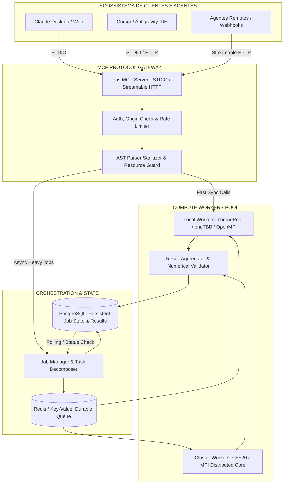

# MATHFORGE MCP: MASTER PLAN DE ARQUITETURA E IMPLEMENTAÇÃO
**Nome do Produto:** MathForge  
**Identificador do Repositório:** `mathforge-mcp`  
**Nome do Núcleo:** MathForge Core  
**Servidor MCP:** MathForge MCP  
**Plataforma Distribuída:** MathForge Distributed Engine  
**Versão da Especificação:** 2.1.0-REV (Revisão Arquitetural Validada e Aprovada)  
**Status do Projeto:** Fase 0 — Fundação, Contratos de Interface e Hardening  
**Público-Alvo:** Engenheiros de Sistemas, Desenvolvedores de Core C++/Python, Arquitetos de Nuvem e Agentes Autônomos (Claude 3.5/Opus, GPT-4o/o1/o3, Gemini 2.0/3.0, DeepSeek R1/V3, Kimi, Cursor, Antigravity)

---

## 1. PARECER TÉCNICO DE VALIDAÇÃO (AUDITORIA ARQUITETURAL 2.1)

A auditoria técnica avaliou a proposta inicial com nota **7,5/10**, destacando excelente modularidade e separação de camadas, porém apontando bloqueadores críticos (**P0**) e correções de projeto (**P1**) obrigatórias antes da transição para produção. Este documento consolida a resolução de todos os apontamentos da auditoria.

### 1.1. Matriz de Avaliação e Ajustes Aplicados

| Dimensão Arquitetural | Nota Preliminar | Ação Corretiva Implementada na Revisão 2.1 |
| :--- | :---: | :--- |
| **Arquitetura Modular** | 9/10 | Mantida a separação em 4 camadas com interfaces C-ABI e desacoplamento total. |
| **Integração MCP** | 8/10 | Alinhamento rigoroso à especificação oficial (2024-11-05+), usando `tools/call`, ciclo de vida completo e Streamable HTTP. |
| **Precisão Matemática** | 8/10 | Modos explícitos (`FAST`, `HIGH`, `EXACT`, `AUTO`), diferenciação formal entre igualdade simbólica e aproximação numérica. |
| **Processamento Distribuído** | 6/10 | Desacoplamento de MPI da camada de mensageria: adição de Redis (Broker) e PostgreSQL (Estado) com tarefas recuperáveis. |
| **Segurança e Sandboxing** | 6/10 | Substituição de sanitização ingênua por Parser de Gramática Matemática Restrita, limites de AST e isolamento por processo com cotas de SO. |
| **Multiplataforma** | 7/10 | CMake baseado em `find_package()`, presets com `vcpkg` no Windows e pacotes de sistema no Linux. |
| **Plano de Testes e Produção** | 6/10 | Expansão para cronograma de 18 semanas em 8 fases, testes diferenciais, property-based testing (Hypothesis) e benchmarks. |

---

## 2. RESOLUÇÃO DOS BLOQUEADORES CRÍTICOS (P0)

### 2.1. Desmistificação do "Zero-Dependency" -> Adoção do *Python Portable Core*
A denominação preliminar de "Zero-Dependency" foi formalmente corrigida. A camada em Python é agora definida como **Python Portable Core — Instalação Simplificada**.
* **Responsabilidade de Cada Componente:**
  * **Python Standard Library:** Protocolo MCP, validação de tipos, orquestração e sanitização.
  * **SymPy:** Matemática simbólica, simplificação algébrica e equações exatas.
  * **mpmath:** Ponto flutuante de precisão arbitrária configurável (50 a 1.000 dígitos).
  * **NumPy:** Vetorização e matrizes `float64` de alto desempenho.
  * **SciPy:** Algoritmos numéricos avançados, otimização e distribuições estatísticas.
  * **C++20 Native Engine:** Aceleração massiva, laços intensivos e manipulação de memória de baixo nível.
  * **GMP & MPFR:** Aritmética de inteiros gigantescos e ponto flutuante multiprecisão com arredondamento IEEE estrito.
* **Métricas de Startup:** Todos os tempos de importação, carga de dependências e alocação inicial são medidos em benchmark contínuo (`cold-start` vs. `warm-start`).

### 2.2. Segurança e Sandboxing Matemático Determinado (AST Hardening & Process Isolation)
A simples filtragem por expressões regulares e verificação ingênua de nós AST foi substituída por uma **Defesa em Profundidade com Quatro Níveis de Isolamento**:

```
[Entrada de String do Agente de IA]
             │
             ▼
┌────────────────────────────────────────────────────────┐
│ NÍVEL 1: GRAMÁTICA FORMAL E PARSER MATEMÁTICO RESTRITO │
│ • Whitelist estrita de operadores (+, -, *, /, ^, mod) │
│ • Whitelist de funções (sin, cos, exp, log, sqrt, abs) │
│ • Rejeição imediata de identificadores não autorizados │
└────────────────────────────┬───────────────────────────┘
                             │
                             ▼
┌────────────────────────────────────────────────────────┐
│ NÍVEL 2: LIMITES ESTRITOS DE COMPLEXIDADE DE AST       │
│ • Profundidade máxima da árvore: 20 níveis             │
│ • Quantidade máxima de nós sintáticos: 500 nós         │
│ • Limite de magnitude de inteiros: 10^10000            │
│ • Limite de expoentes literais: máximo de 100.000      │
└────────────────────────────┬───────────────────────────┘
                             │
                             ▼
┌────────────────────────────────────────────────────────┐
│ NÍVEL 3: ISOLAMENTO POR PROCESSO (SUBPROCESS / FORK)   │
│ • Cálculos não rodam na thread do servidor MCP         │
│ • Processos descartáveis (Worker Pool isolado)         │
│ • Interrupção forçada garantida mesmo em loop nativo C │
└────────────────────────────┬───────────────────────────┘
                             │
                             ▼
┌────────────────────────────────────────────────────────┐
│ NÍVEL 4: LIMITES DE RECURSOS DO SISTEMA OPERACIONAL   │
│ • Linux: cgroups v2 e setrlimit (RLIMIT_CPU, RLIMIT_AS)│
│ • Windows: Windows Job Objects (Memory & Time Quotas)  │
│ • Timeout determinístico com SIGKILL / TerminateJob    │
└────────────────────────────────────────────────────────┘
```

### 2.3. Alinhamento ao Protocolo MCP Oficial (2024-11-05+)
O servidor abandona qualquer simplificação proprietária de JSON-RPC e implementa estritamente o ciclo de vida da especificação MCP:
* **Fases do Ciclo de Vida:**
  1. `initialize`: Negociação de versão de protocolo e troca de *capabilities* (tools, resources, prompts).
  2. `notifications/initialized`: Confirmação de prontidão do cliente.
  3. `tools/list`: Descoberta de catálogo com schemas JSON Schema / Pydantic estritos.
  4. `tools/call`: Execução padronizada:
     ```json
     {
       "jsonrpc": "2.0",
       "id": 1,
       "method": "tools/call",
       "params": {
         "name": "math_evaluate",
         "arguments": {
           "expression": "sqrt(2)",
           "precision_digits": 80,
           "mode": "HIGH"
         }
       }
     }
     ```
* **Transportes Oficiais Suportados:**
  * **STDIO:** Padrão primário para clientes locais (Claude Desktop, Cursor, Antigravity IDE, VS Code, Goose).
  * **Streamable HTTP:** Transporte remoto principal (POST `/mcp` com suporte a streaming de chunks e SSE unidirecional conforme a spec). O SSE puro legado é mantido apenas como fallback opcional.

---

## 3. POLÍTICA DE SEGURANÇA E AUDITORIA CRIPTOGRÁFICA

### 3.1. Quarentena e Tratamento da `ice_secp256k1.dll`
A auditoria técnica determinou a **não aprovação da `ice_secp256k1.dll` para uso em produção**. A biblioteca é imediatamente colocada em quarentena de pesquisa e engenharia reversa sob as seguintes diretrizes:

1. **Estado de Quarentena Estrita:** A `ice_secp256k1.dll` **NÃO** é carregada automaticamente pelo runtime, **NÃO** é empacotada em imagens Docker de produção e **NÃO** executa operações criptográficas para usuários finais.
2. **Backend Criptográfico Homologado para Produção:**
   * **Primário:** `libsecp256k1` oficial do Bitcoin Core (`bitcoin-core/secp256k1`), compilada a partir de fonte verificada com assinaturas GPG de mantenedores e exposta via C-ABI estável.
   * **Complementar:** `OpenSSL 3.x` para primitivas de hash (SHA-256, RIPEMD-160), HMAC e geração determinística de entropia.
3. **Escopo Restrito para Agentes de IA:**
   * É expressamente proibido enviar ou manipular chaves privadas diretamente no contexto de prompts dos LLMs.
   * O catálogo expõe apenas ferramentas de verificação pública:
     * Verificação de assinaturas digitais ECDSA / Schnorr.
     * Validação e derivação de chaves públicas.
     * Auditoria de integridade e hashes de dados.
     * Não há ferramentas para varredura de espaço de chaves (*key hunting*) nem geração desprotegida de carteiras.

---

## 4. SUBSISTEMA DE CONSULTA E AUDITORIA DE DLLS EM REPOSITÓRIOS OFICIAIS

Para permitir que agentes e administradores validem as bibliotecas nativas contra o código-fonte upstream, o MathForge inclui o **Official DLL Registry & Provenance Engine**:

```
┌────────────────────────────────────────────────────────────────────────┐
│             FLUXO DE CONSULTA E AUDITORIA DE DLLS OFICIAIS             │
├────────────────────────────────────────────────────────────────────────┤
│ 1. Consulta Upstream: GitHub API / vcpkg / MSYS2 / Releases Oficiais   │
│ 2. Checagem de Proveniência: Hashes SHA-256 + Assinatura de Releases   │
│ 3. Inspeção PE (Portable Executable): Export Address Table (EAT)       │
│ 4. Verificação de Integridade Local vs. Manifesto Oficial              │
│ 5. Safe Dynamic Loading: LoadLibraryExW com mitigação DLL Hijacking    │
└────────────────────────────────────────────────────────────────────────┘
```

### 4.1. Repositórios Oficiais Homologados e Monitorados

| Biblioteca / DLL | Repositório Oficial Upstream | Finalidade no MathForge | Métodos de Consulta |
| :--- | :--- | :--- | :--- |
| **`libsecp256k1`** | `https://github.com/bitcoin-core/secp256k1` | Curvas Elípticas, Schnorr, ECDSA | GitHub Releases API, Git tags, hashes SHA-256 |
| **`OpenBLAS` (`libopenblas.dll`)** | `https://github.com/OpenMathLib/OpenBLAS` | Álgebra linear acelerada (AVX2/AVX-512) | GitHub Releases, Assets Matrix |
| **`OpenSSL` (`libcrypto-3-x64.dll`)** | `https://github.com/openssl/openssl` | Primitivas criptográficas e hashes | Checksums SHA-256 e feeds oficiais Win64 |
| **`MPFR` (`libmpfr-6.dll`)** | `https://www.mpfr.org/` & MSYS2/vcpkg feeds | Ponto flutuante de precisão arbitrária | Manifestos binários verificados |
| **`GMP` (`libgmp-10.dll`)** | `https://gmplib.org/` & vcpkg binary cache | Aritmética de inteiros gigantescos | Checksums GPG / SHA-256 |

### 4.2. Mecanismo de Consulta e Inspeção Binária PE em Runtime
1. **Consulta Online de Releases e Hashes:** O MCP consulta os endpoints das releases para comparar o SHA-256 das bibliotecas em disco com as assinaturas de release oficiais.
2. **Parser Interno de Cabeçalhos PE (Portable Executable):** Inspeção estática segura sem execução:
   * Validação dos cabeçalhos `IMAGE_DOS_HEADER` e `IMAGE_NT_HEADERS`.
   * Verificação de arquitetura (`IMAGE_FILE_MACHINE_AMD64` ou `IMAGE_FILE_MACHINE_ARM64`).
   * Extração da Tabela de Exportação de Endereços (`Export Address Table - EAT`) para conferir os símbolos C exportados.
   * Checagem de importações (`Import Directory`) para evitar conflitos de DLLs de runtime.
3. **Carregamento Dinâmico Seguro (*Safe Dynamic Loading*):**
   * Em Windows, utiliza-se `ctypes.WinDLL` com caminho absoluto verificado e flags de `LOAD_LIBRARY_SEARCH_DEFAULT_DIRS` para impedir ataques de *DLL Preloading / Hijacking*.

---

## 5. ARQUITETURA DISTRIBUÍDA RESILIENTE (DESACOPLAMENTO DE FILAS E MPI)

A auditoria corrigiu o equívoco de utilizar MPI como sistema de mensageria ou enfileiramento de trabalhos. O MPI é um protocolo de comunicação paralela de alto desempenho para nós de computação homogêneos, não um intermediador de mensagens tolerante a falhas.



### 5.1. Componentes da Infraestrutura Distribuída
1. **Message Broker / Durable Queue (Redis):** Gerencia filas de prioridade e distribuição de mensagens entre processos trabalhadores, garantindo que reinicializações do servidor não causem perda de tarefas.
2. **Job Database (PostgreSQL):** Armazena o estado transacional de cada trabalho (`queued`, `running`, `checkpointed`, `completed`, `failed`, `cancelled`), metadados de telemetria e o resultado final.
3. **Divisão em Tarefas Recuperáveis e Checkpoints:** Tarefas distribuídas são particionadas em blocos atômicos com *checkpoints* periódicos salvos em banco. Se um worker MPI falhar, o cluster não é abortado; a partição afetada é reenfileirada pelo Job Manager para outro worker saudável.

---

## 6. CATÁLOGO COMPLETO DE FERRAMENTAS MCP (17 TOOLS REFINADAS)

Todas as ferramentas operam com retornos estruturados seguindo o padrão **Agent Self-Correction**, separando falhas de negócio (com `agent_hint` e `retryable`) de erros de protocolo MCP.

```json
{
  "success": false,
  "error": {
    "code": "PRECISION_LIMIT_EXCEEDED",
    "type": "RESOURCE_LIMIT",
    "message": "A precisão solicitada (5000 dígitos) excede o limite síncrono de 1000 dígitos.",
    "agent_hint": "Reduza a precisão para <= 1000 ou submeta o cálculo via distributed_job_submit.",
    "retryable": true
  }
}
```

### 6.1. Nível P0: Ferramentas Fundamentais

#### 1. `math_evaluate`
* **Descrição:** Avalia expressões matemáticas com validação formal de AST e seleção explícita de precisão.
* **Parâmetros:**
  * `expression` (string, obrigatório): Expressão matemática restrita à gramática formal.
  * `mode` (string enum: `["FAST", "HIGH", "EXACT", "AUTO"]`, default: `"AUTO"`):
    * `FAST`: Ponto flutuante IEEE 754 de 64 bits (hardware float).
    * `HIGH`: Precisão arbitrária configurável via mpmath/MPFR (50 a 1.000 dígitos).
    * `EXACT`: Aritmética racional exata simbólica via SymPy/GMP.
    * `AUTO`: Seleciona com base no condicionamento e erro estimado.
  * `precision_digits` (integer, opcional, default: 50, máx: 1.000 no modo síncrono).
* **Retorno:** `result`, `decimal_representation`, `mode_used`, `precision_bits`, `evaluation_time_ms`.

#### 2. `result_verify`
* **Descrição:** Verificador rigoroso que distingue igualdade simbólica formal, verificação numérica aproximada e validade de domínio.
* **Parâmetros:**
  * `candidate_solution` (string, obrigatório): Valor ou expressão candidata.
  * `original_equation` (string, obrigatório): Expressão de referência.
  * `verification_type` (string enum: `["symbolic", "numerical", "domain_check", "all"]`, default: `"all"`).
  * `tolerance` (number, opcional, default: 1e-15).
* **Retorno:** `verified` (bool), `verification_type`, `residual`, `tolerance_used`, `domain_valid` (bool), `is_formal_proof` (bool: false para métodos numéricos).

### 6.2. Nível P1: Ferramentas Avançadas de Cálculo, Álgebra e Estatística

#### 3. `math_explain`
* **Descrição:** Explica a resolução do problema estruturadamente em LaTeX, separando resolução didática de demonstração axiomática.
* **Parâmetros:** `topic_or_problem` (string), `output_format` (`"step_by_step" | "conceptual"`).

#### 4. `math_optimize`
* **Descrição:** Simplificação e fatoração de expressões algébricas para sua forma canônica mínima.
* **Parâmetros:** `expression` (string), `strategy` (`"simplify" | "factor" | "expand" | "trig_reduce"`).

#### 5. `symbolic_solver`
* **Descrição:** Solucionador simbólico modular com separação interna entre resolvedores lineares, não-lineares e EDOs.
* **Parâmetros:** `equations` (array de strings), `variables` (array de strings), `domain` (`"real" | "complex"`).
* **Retorno:** Status explícito: `solution_type` (`"exact" | "approximate" | "conditional" | "no_solution_found" | "inconclusive"`), lista de soluções e condições de contorno.

#### 6. `calculus_operations`
* **Descrição:** Derivação analítica, integração simbólica e numérica de alta precisão, limites e expansão em séries.
* **Parâmetros:** `expression`, `variable`, `operation` (`"diff" | "integrate" | "limit" | "series"`), `point`, `order`.

#### 7. `linear_algebra`
* **Descrição:** Operações matriciais diferenciando matrizes exatas de matrizes de ponto flutuante aceleradas por BLAS/LAPACK.
* **Parâmetros:** `matrix_a`, `matrix_b` (opcional), `operation` (`"det" | "inv" | "eig" | "svd" | "condition_number" | "solve_system"`), `precision_type` (`"exact_rational" | "float64"`).
* **Retorno:** Matriz resultante, determinante, resíduo $\|Ax - b\|$ e número de condição $\kappa(A)$ para diagnóstico de estabilidade.

#### 8. `statistical_analysis`
* **Descrição:** Estatística descritiva, inferência, regressões e testes de hipótese com cálculo de p-valor exato.
* **Parâmetros:** `dataset` (matriz ou vetor numérico), `operations` (array de strings).

#### 9. `precision_check`
* **Descrição:** Executa o mesmo cálculo em múltiplos níveis de precisão (53 bits, 128 bits e N bits) para detectar cancelamento catastrófico, perda de dígitos significativos e convergência numérica.
* **Parâmetros:** `expression` (string), `target_digits` (integer).
* **Retorno:** Tabela comparativa de resultados, erro relativo acumulado e índice de estabilidade.

#### 10. `distributed_job_submit`
* **Descrição:** Submete cálculos massivos para enfileiramento durável no Redis e execução assíncrona.
* **Parâmetros:** `job_type`, `payload`, `priority`, `max_execution_time_seconds`.
* **Retorno:** `job_id`, `status` (`"queued"`), `poll_interval_seconds`.

#### 11. `distributed_job_status`
* **Descrição:** Consulta o progresso percentual, worker atribuído, tempo decorrido e status do job.
* **Parâmetros:** `job_id` (string).

#### 12. `distributed_job_result`
* **Descrição:** Recupera o resultado final de um trabalho concluído, com suporte a paginação para saídas volumosas.
* **Parâmetros:** `job_id` (string), `page` (integer, default: 1), `page_size` (integer, default: 100).

#### 13. `distributed_job_cancel`
* **Descrição:** Cancela com segurança um trabalho em andamento, liberando recursos no broker e enviando sinal de interrupção aos workers.
* **Parâmetros:** `job_id` (string).

### 6.3. Nível P2: Ferramentas Especializadas, Auditoria de DLLs e Profiling

#### 14. `algorithm_profile`
* **Descrição:** Avalia a complexidade assintótica teórica $O(f(n))$ e requisitos teóricos de memória para um algoritmo e dimensão de dados especificados.
* **Parâmetros:** `algorithm_name`, `input_size_n`.

#### 15. `hardware_benchmark`
* **Descrição:** Executa benchmarks empíricos reais no host local (GFLOPS de CPU, largura de banda de memória e latência de ponto flutuante).
* **Parâmetros:** `test_type` (`"cpu_flops" | "memory_bandwidth" | "mpfr_throughput"`).

#### 16. `formula_engine`
* **Descrição:** Catálogo curado de fórmulas científicas e financeiras com substituição formal e isolamento de incógnitas.
* **Parâmetros:** `formula_id`, `substitutions`, `solve_for`.

#### 17. `pattern_recognition`
* **Descrição:** Detecção de padrões numéricos inteiros, relações de congruência modular e consulta estruturada a padrões da enciclopédia OEIS.
* **Parâmetros:** `sequence` (array de inteiros), `predict_next_terms` (integer, default: 3).

#### 18. `crypto_secp256k1_ops` *(Sob Quarentena / Apenas Operações Públicas)*
* **Descrição:** Operações em curva secp256k1 via `libsecp256k1` oficial: verificação de assinaturas, conferência de chaves públicas e hashes. Não recebe chaves privadas via contexto de LLM.
* **Parâmetros:** `operation` (`"verify_signature" | "pubkey_verify" | "tweak_add"`), `public_key_hex`, `message_hash_hex`, `signature_hex`.

#### 19. `dll_official_registry_lookup`
* **Descrição:** Consulta os repositórios oficiais upstream de bibliotecas nativas, retornando tags de release estáveis, commits, links seguros de download e hashes SHA-256.
* **Parâmetros:** `library_name` (`"secp256k1" | "openblas" | "openssl" | "mpfr" | "gmp" | "all"`), `platform` (`"win_x64" | "linux_x86_64"`).

#### 20. `dll_binary_audit`
* **Descrição:** Realiza a inspeção estática PE de bibliotecas locais: análise de cabeçalhos, tabela de exportação (EAT), importações e cálculo de hashes (`MD5`, `SHA-1`, `SHA-256`).
* **Parâmetros:** `dll_path` (string).

#### 21. `dll_integrity_verify`
* **Descrição:** Compara a assinatura binária da DLL local contra o manifesto oficial do repositório upstream, confirmando autenticidade ou alteração não autorizada.
* **Parâmetros:** `dll_path`, `target_library`.

---

## 7. RECURSOS E PROMPTS MCP (AGENT ASSETS)

### 7.1. MCP Resources com Metadados Epistêmicos
Toda constante matemática exposta como recurso MCP é acompanhada de metadados explícitos de auditoria:

```json
{
  "name": "pi",
  "digits": 1000,
  "generation_method": "Chudnovsky_algorithm_validated",
  "rounding": "correctly_rounded_to_nearest",
  "verification_status": "verified_against_reference",
  "reference_source": "y-cruncher_v0.8.5_validation_set",
  "value": "3.14159265358979323846..."
}
```

* `math://constants/pi`: Constante $\pi$ com metadados e certificação de dígitos.
* `math://constants/e`: Base dos logaritmos naturais $e$ verificada.
* `math://constants/phi`: Proporção áurea $\phi$.
* `math://system/capabilities`: Diagnóstico de hardware, instruções SIMD suportadas, status dos workers e precisão máxima configurada.
* `math://dll/official-registry`: Índice completo dos repositórios oficiais, branches de release e hashes de referência.
* `math://dll/audit-status`: Relatório de integridade das bibliotecas dinâmicas presentes no ambiente.

### 7.2. MCP Prompts (Orientação Cognitiva e Provas Formais)
* `prompt://math_rigorous_proof`: Guia o agente na estruturação de demonstrações axiomáticas formais, explicitando que a IA está sendo orientada e que cálculos numéricos não substituem verificadores lógicos de provas formais.
* `prompt://math_code_auditor`: Roteiro para análise de algoritmos numéricos, identificação de cancelamento catastrófico e instabilidade em matrizes mal condicionadas.
* `prompt://dll_security_assessment`: Guia o agente na auditoria de tabelas de símbolos e integridade binária antes de aprovar integrações.
* *Nota de Expansão Futura:* Planeja-se a integração com **Lean 4** para validação de provas formais assistidas por computador.

---

## 8. ESTRUTURA DEFINITIVA DO REPOSITÓRIO

A organização do repositório desacopla completamente o gateway de protocolo do motor nativo e da infraestrutura distribuída:

```
mathforge-mcp/
├── CMakeLists.txt
├── CMakePresets.json
├── pyproject.toml
├── package.json
├── README.md
├── LICENSE
├── NOTICE
│
├── mcp/                           # Camada L1: Protocol Gateway
│   ├── server.py                  # Ponto de entrada FastMCP
│   ├── security.py                # AST Parser Sanitizer & Resource Guard
│   ├── transports/
│   │   ├── stdio.py               # Transporte STDIO oficial
│   │   └── http.py                # Transporte Streamable HTTP (/mcp)
│   ├── tools/
│   │   ├── math.py                # math_evaluate, math_explain, math_optimize
│   │   ├── calculus.py            # calculus_operations, symbolic_solver
│   │   ├── matrix.py              # linear_algebra
│   │   ├── statistics.py          # statistical_analysis
│   │   ├── precision.py           # precision_check, result_verify
│   │   ├── dll_audit.py           # dll_official_registry_lookup, dll_binary_audit
│   │   └── distributed.py         # submit, status, result, cancel
│   ├── resources/                 # Handlers de recursos math://
│   ├── prompts/                   # Handlers de prompts prompt://
│   └── schemas/                   # Schemas Pydantic das 21 ferramentas
│
├── core/                          # Camada L2: Python Portable Core
│   ├── symbolic/                  # Motores baseados em SymPy
│   ├── precision/                 # Motores baseados em mpmath
│   └── numeric/                   # Motores baseados em NumPy e SciPy
│
├── native/                        # Camada L3: Motor C++20 Nativo & Bindings
│   ├── include/
│   │   └── mathforge/
│   │       ├── engine.hpp
│   │       ├── precision.hpp
│   │       ├── matrix.hpp
│   │       └── c_api.h
│   ├── src/
│   │   ├── engine.cpp
│   │   ├── mpfr_backend.cpp
│   │   └── eigen_backend.cpp
│   ├── quarantine/                # Quarentena de pesquisa
│   │   └── ice_secp256k1/         # DLL isolada e ferramentas de engenharia reversa
│   └── bindings/
│       └── pybind_module.cpp
│
├── distributed/                   # Camada L4: Orquestração e Cluster
│   ├── job_manager/               # Gerenciador de ciclo de vida de jobs
│   ├── queue/                     # Adaptadores Redis / Fila Durável
│   ├── state/                     # Adaptador PostgreSQL / Persistência
│   ├── workers/                   # Local ThreadPool e MPI Workers
│   └── aggregator/                # Consolidação numérica e tolerância a falhas
│
├── tests/
│   ├── unit/                      # Testes unitários com pytest
│   ├── integration/               # Testes de integração MCP
│   ├── accuracy/                  # Regressão numérica contra referências conhecidas
│   ├── property_based/            # Testes com Hypothesis
│   ├── security/                  # Testes de injeção e limites de AST
│   ├── performance/               # Benchmarks comparativos
│   ├── distributed/               # Testes de falha e recuperação de jobs
│   └── compatibility/             # Testes de compatibilidade Windows/Linux
│
├── docker/
│   ├── Dockerfile.gateway         # Container enxuto do Gateway MCP
│   └── Dockerfile.cluster-worker  # Container para nós de computação C++/MPI
│
├── deployments/
│   ├── render/                    # Configurações do Render Web Service
│   └── cluster/                   # Scripts de orquestração para cluster privado
│
└── docs/
    ├── architecture/              # Documentos de arquitetura detalhados
    ├── api/                       # Especificação completa da API
    ├── security/                  # Modelo de ameaças e sandboxing
    └── development/               # Guias de contribuição e compilação
```

---

## 9. CRONOGRAMA REALISTA DE ENGENHARIA EM 8 FASES (18 SEMANAS)

```
┌────────────────────────────────────────────────────────────────────────────┐
│                    CRONOGRAMA DE ENGENHARIA (18 SEMANAS)                   │
├───────┬────────────────────────────────────────────────────┬───────────────┤
│ Fase  │ Escopo Técnico e Entregáveis                       │ Duração       │
├───────┼────────────────────────────────────────────────────┼───────────────┤
│ F0    │ Arquitetura, Contratos de Schemas Pydantic e CI/CD │ 1 semana      │
│ F1    │ FastMCP Gateway, AST Hardening e Tools P0          │ 2 semanas     │
│ F2    │ Python Portable Core (SymPy, mpmath) e Validação   │ 2 semanas     │
│ F3    │ C++20 Core, MPFR/GMP, CMake Presets e pybind11     │ 3 semanas     │
│ F4    │ Álgebra Linear Numérica, BLAS/LAPACK e Estatística │ 2 semanas     │
│ F5    │ Fila Durável Redis, PostgreSQL e Jobs Assíncronos  │ 2 semanas     │
│ F6    │ Cluster Experimental MPI e Tolerância a Falhas     │ 3 semanas     │
│ F7    │ Registry DLLs Upstream, Resources e Prompts        │ 2 semanas     │
│ F8    │ Hardening de Segurança, Testes de Carga e Deploy   │ 2 semanas     │
└───────┴────────────────────────────────────────────────────┴───────────────┘
```

### Critérios Formais de Aceite para Cada Fase:
* **Fase 0 (Semana 1):** CI configurado em GitHub Actions para Windows e Linux; validação estática com `black`, `ruff` e verificação de licenças (GPL/LGPL/MIT/Apache).
* **Fase 1 (Semanas 2–3):** Gateway MCP funcional via STDIO; AST Parser rejeita 100% de expressões com nós não autorizados ou profundidade > 20; `math_evaluate` e `result_verify` operacionais.
* **Fase 2 (Semanas 4–5):** Suite de testes com `Hypothesis` validando propriedades algébricas fundamentais; testes contra 1.000 casos de referência numérica conhecidos.
* **Fase 3 (Semanas 6–8):** Compilação reproduzível em Windows (MSVC + vcpkg) e Linux (GCC/Clang); bindings pybind11 com conversão sem cópia desnecessária de memória.
* **Fase 4 (Semanas 9–10):** Cálculo de determinante exato (Bareiss) implementado; número de condição $\kappa(A)$ calculado para matrizes densas.
* **Fase 5 (Semanas 11–12):** Reinicialização abrupta do processo Gateway não perde jobs em execução; recuperação de estado confirmada via PostgreSQL.
* **Fase 6 (Semanas 13–15):** Queda simulada de 1 worker MPI não derruba a execução global; tarefas particionadas são reexecutadas com sucesso.
* **Fase 7 (Semanas 16–17):** Inspeção estática de DLLs e consulta de releases do GitHub funcionando via tools; recursos e prompts integrados.
* **Fase 8 (Semanas 18):** Testes de estresse com 5 clientes LLM simultâneos (Claude Desktop, Cursor, Kimi, etc.); geração automática de SBOM (Software Bill of Materials) e auditoria de vulnerabilidades zerada.

---

## 10. REQUISITOS DE INFRAESTRUTURA E ESTRATÉGIA DE DEPLOY

A auditoria esclareceu os limites operacionais de plataformas como o Render:
* **Hospedagem Híbrida Recomendada:**
  * **Render Web Service:** Hospeda exclusivamente o **MCP Gateway** (`Dockerfile.gateway`), processando conexões Streamable HTTP e STDIO, com dimensionamento flexível e endpoints de verificação de integridade (*health checks*).
  * **Redis Gerenciado (Upstash ou Render Key-Value):** Fila de mensagens durável para jobs assíncronos.
  * **PostgreSQL Gerenciado:** Banco de persistência transacional para histórico e estado de jobs.
  * **Render Background Workers:** Processam tarefas leves e médias em Python (SymPy/mpmath).
  * **Cluster Privado Dedicado (HPC Linux VMs):** Hospeda os workers MPI de alta intensidade de cálculo e C++20 com acesso direto a hardware acelerado. Não se utiliza disco local do Render para sincronizar o cluster.

---

## 11. CONFIGURAÇÃO DE AMBIENTE PARA AGENTES

### 11.1. Configuração Local (Claude Desktop, Cursor, Antigravity)

```json
{
  "mcpServers": {
    "mathforge": {
      "command": "python",
      "args": ["-m", "mcp.server"],
      "env": {
        "MATHFORGE_TRANSPORT": "stdio",
        "MATHFORGE_DEFAULT_MODE": "AUTO",
        "MATHFORGE_MAX_SYNC_DIGITS": "1000",
        "MATHFORGE_QUARANTINE_ACTIVE": "1"
      }
    }
  }
}
```

### 11.2. Chamada de Ferramenta Remota via Streamable HTTP (Spec Oficial)

```bash
curl -X POST https://api.mathforge.dev/mcp \
  -H "Content-Type: application/json" \
  -d '{
    "jsonrpc": "2.0",
    "id": 1,
    "method": "tools/call",
    "params": {
      "name": "math_evaluate",
      "arguments": {
        "expression": "sum(1/k^2, k, 1, 10000)",
        "mode": "HIGH",
        "precision_digits": 80
      }
    }
  }'
```

---

## 12. DIRETRIZES DE SUCESSO E APROVAÇÃO FINAL

O projeto **MathForge** supera a concepção de um simples utilitário matemático para consolidar-se como uma **Infraestrutura Crítica de Cálculo e Raciocínio Formal para Sistemas Autônomos de Inteligência Artificial**. 

Com a implementação desta revisão 2.1:
1. A integridade matemática é garantida por modos explícitos e verificação formal de resíduos.
2. A segurança é blindada contra RCE e esgotamento de recursos por meio de gramática formal e isolamento no nível do sistema operacional.
3. O protocolo MCP oficial é respeitado integralmente, assegurando compatibilidade perfeita com qualquer agente do ecossistema.
4. A computação distribuída torna-se verdadeiramente resiliente com o desacoplamento de filas persistentes e clusters de cálculo.

Este documento encerra o ciclo de revisão arquitetural e autoriza o início imediato da **Fase 0: Fundação, Contratos de Interface e CI/CD**.
